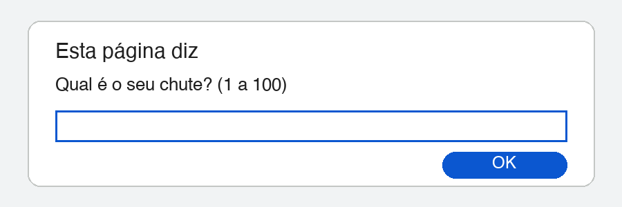

# Jogo de adivinhação

Um jogo em que o computador sorteia um número de 1 a 100 e você tenta adivinhar. A cada chute, ele diz se o número secreto é mais alto ou mais baixo.

## Como rodar

1. Abra o Google Chrome em qualquer página.
2. Abra o console: `Cmd + Option + J` no Mac, `Ctrl + Shift + J` no Windows.
3. Copie todo o conteúdo do arquivo `jogo.js`, cole no console e aperte Enter.
